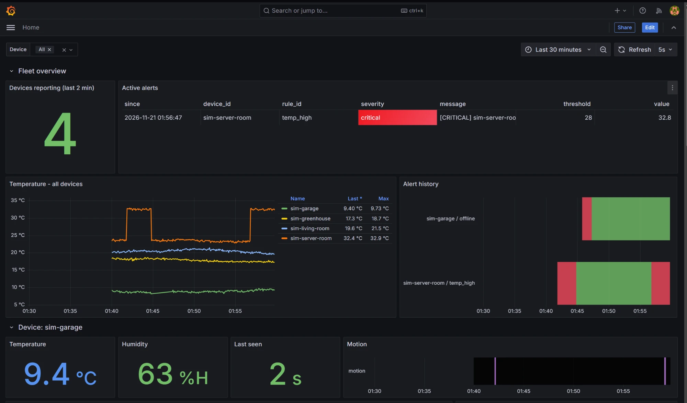
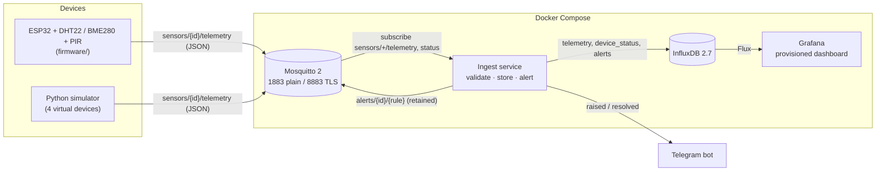

# IoT Sensor Panel

🇹🇷 [Türkçe](README.tr.md)

[](LICENSE)


A smart sensor dashboard built end to end: ESP32 sensor nodes (or a Python
simulator) publish temperature, humidity, pressure and motion over MQTT, a
Python service validates and stores the readings in InfluxDB 2, and Grafana
shows a live panel per device. Threshold and offline alerts go to Telegram.

The part I care most about is the **security showcase**: the same stack runs
in an `insecure` mode (plain MQTT, anonymous) and a `secure` mode (TLS,
passwords, per-device ACL), with a Wireshark walkthrough of the difference.



*The dashboard running on my machine with the simulated sensors: a critical
temperature alert on the server room, and the garage sensor going offline and
recovering in the alert history.*

| Live dashboard | Alerts in Telegram |
| --- | --- |
| *Demo GIF placeholder: `docs/img/dashboard-demo.gif` (not recorded yet)* | *Screenshot placeholder: `docs/img/telegram-alert.png`* |

See [docs/img/README.md](docs/img/README.md) for what each image will show.

## Architecture



- **Simulator** (`src/iot_panel/simulator.py`): diurnal temperature curve,
  mean-reverting drift, sensor noise, anti-correlated humidity, time-of-day
  dependent motion; fault injection for silent devices and heat spikes.
- **Ingest** (`src/iot_panel/ingest.py`): strict payload validation (types,
  physical ranges, timestamp skew, `device_id` must match the topic), batched
  InfluxDB writes, alert evaluation.
- **Alerts** (`src/iot_panel/alerts/`): YAML rules with hysteresis, per-device
  overrides, offline detection, Telegram/console notifications, alert state
  in MQTT and InfluxDB.
- **Firmware** (`firmware/`): PlatformIO project for ESP32 with DHT22 or BME280,
  optional PIR, TLS with a pinned CA.

## Quick start

Requirements: Docker with Compose v2.

```bash
docker compose up --build
```

Then open <http://localhost:3000> (user `admin`, password `change-me-grafana`).
The **IoT Sensor Panel** dashboard is the home page: within a few seconds the
four simulated devices appear, and the built-in demo faults make the server
room overheat and the garage sensor go silent every 15 minutes, so you can
watch alerts being raised and resolved.

Every setting has a development default. To change passwords, tokens or the
simulator, copy `.env.example` to `.env` and edit it before the first start
(InfluxDB applies its setup only once, on an empty volume).

| Service | URL / port |
| --- | --- |
| Grafana | <http://localhost:3000> |
| InfluxDB UI | <http://localhost:8086> (`admin` / `change-me-influx`) |
| MQTT | `localhost:1883` (insecure) or `localhost:8883` (secure) |

### Without Docker

The Python parts run anywhere with Python 3.11+:

```bash
python -m venv .venv && source .venv/bin/activate   # Windows: .venv\Scripts\activate
pip install -e ".[dev]"

# print simulated telemetry instead of publishing it
iot-simulator --dry-run --count 3

# fast-forward 10 minutes with a heat spike and a silent device
iot-simulator --dry-run --fast --interval 10 --count 60 \
  --spike sim-server-room:120:180:9 --silence sim-garage:200:200
```

## Telemetry payload

Published to `sensors/<device_id>/telemetry` by both the simulator and the
firmware:

```json
{
  "v": 1,
  "device_id": "sim-server-room",
  "ts": 1763496000.25,
  "seq": 42,
  "temperature": 24.31,
  "humidity": 35.2,
  "pressure": 1009.8,
  "motion": false,
  "rssi": -61,
  "fw": "sim-0.1.0"
}
```

`ts` is optional (the ingest service falls back to the receive time); at least
one of `temperature`, `humidity`, `pressure`, `motion` is required. Readings
outside the sensors' physical range, with a `device_id` that differs from the
topic, or with a timestamp more than five minutes in the future are rejected
and counted, never stored. Devices also publish a retained `online`/`offline`
status with an MQTT last will to `sensors/<device_id>/status`.

## Alerting

Rules live in [`config/alerts.yaml`](config/alerts.yaml), which is mounted into
the ingest container (restart `ingest` after editing):

```yaml
offline:
  timeout_seconds: 60          # no telemetry for 60 s -> "offline"
  check_interval_seconds: 5
  severity: critical

rules:
  - id: temp_high
    metric: temperature
    above: 30.0                # raised when > 30.0
    hysteresis: 1.0            # resolved only when < 29.0
    severity: warning

devices:
  sim-server-room:
    offline_timeout_seconds: 30
    rules:
      temp_high: {above: 28.0, severity: critical}
```

- **Hysteresis** means a value hovering around the threshold produces one
  alert, not a notification storm. `tests/test_alert_rules.py` feeds the same
  noisy signal with and without hysteresis to show the difference.
- **Offline detection** reports a device that stopped sending for N seconds
  (per device configurable) and sends a recovery notice when it comes back.
  `expected_devices` also catches a device that never reported at all.
- **Notifications:** alerts are always logged by the ingest service. To get
  them in Telegram, create a bot with @BotFather and set `TELEGRAM_BOT_TOKEN`
  and `TELEGRAM_CHAT_ID` in `.env`. Resolved notices are sent silently.
- **State for Grafana:** every transition is written to the `alerts`
  measurement (shown in the *Active alerts* table and *Alert history*
  timeline) and published retained to `alerts/<device_id>/<rule_id>`. After a
  restart the ingest service reads that retained state back, so an alert that
  cleared while it was down is still resolved properly.

## Hardware

The firmware publishes the exact same payload, so a real board appears in the
dashboard next to the simulated ones.

| Sensor | ESP32 pins | PlatformIO env |
| --- | --- | --- |
| DHT22 | DATA -> GPIO 4 (10 kΩ pull-up to 3V3) | `esp32-dht22` |
| BME280 (I2C, 0x76) | SDA -> GPIO 21, SCL -> GPIO 22 | `esp32-bme280` |
| HC-SR501 PIR (optional) | OUT -> GPIO 27, VCC -> 5V | both |

```bash
cd firmware
cp include/secrets.example.h include/secrets.h   # WiFi, broker, password, CA cert
pio run -e esp32-dht22 -t upload && pio device monitor
```

`secrets.h` is git-ignored. With `MQTT_USE_TLS 1` the board verifies the
broker against the local CA (time is synced over NTP first so certificate
validity can be checked). Full wiring tables, BOM and the secure setup for a
board are in [docs/hardware.md](docs/hardware.md).

*Photo placeholder: `docs/img/hardware.jpg`*

## Security: before and after

| | `insecure` (default) | `secure` |
| --- | --- | --- |
| Transport | plain TCP on 1883 | TLS 1.2+ on 8883 only |
| Who can connect | anyone | username + password only |
| Who can publish where | anyone, anywhere | each device only to `sensors/<own id>/...` (ACL) |
| Broker identity | not verified | certificate from a local CA, host name checked |
| InfluxDB / Grafana | all interfaces | `127.0.0.1` only |

| Plain MQTT on the wire | MQTT over TLS on the wire |
| --- | --- |
| *Screenshot placeholder: `docs/img/wireshark-insecure.png` - topic, JSON payload and CONNECT password readable* | *Screenshot placeholder: `docs/img/wireshark-secure.png` - TLS handshake, then only Application Data* |

Run the secure stack:

```bash
cp .env.example .env                              # set real MQTT passwords
python scripts/gen_certs.py                       # local CA + broker cert (or scripts/gen_certs.sh)
python scripts/make_passwd.py --from-env .env     # Mosquitto password file
docker compose -f docker-compose.yml -f docker-compose.secure.yml up --build
```

Certificates, the password file and `.env` are generated locally and
git-ignored. The step-by-step capture guide (capture filters, where to capture
with Docker Desktop, what you see in each mode, how to show the ACL stopping a
spoofed device) is in [docs/security-demo.md](docs/security-demo.md).

The core claim is also tested automatically: `tests/test_tls_wire.py` puts a
recording TCP proxy between the real MQTT client code and a fake broker and
asserts that password and payload are in the captured bytes over plain MQTT
and absent over TLS, and that a broker with a certificate from another CA or
for another host name is rejected.

## Project layout

```
.
├── src/iot_panel/          # simulator, ingest service, alerting (Python package)
│   └── alerts/             # rule config, state machine, notifiers/sinks
├── config/alerts.yaml      # alert rules
├── firmware/               # ESP32 PlatformIO project
├── grafana/                # datasource + dashboard provisioning, dashboard JSON
├── mosquitto/config/       # insecure/secure broker config, ACL
├── scripts/                # cert + password generation, smoke test
├── tests/                  # pytest suite
├── docs/                   # hardware guide, security demo
├── docker-compose.yml      # insecure stack (default)
└── docker-compose.secure.yml
```

## Development

```bash
pip install -e ".[dev]"
pytest              # unit + integration tests, no Docker needed
ruff check . && ruff format --check .
```

The tests cover payload validation, hysteresis and offline detection with a
fake clock, the simulator, the ingest service with fake MQTT/InfluxDB clients,
an in-process simulator -> ingest -> alert pipeline, Telegram requests,
certificate and password-file generation, and static checks of the Compose,
Mosquitto, ACL and Grafana files.

CI (`.github/workflows/ci.yml`) runs ruff and pytest on Python 3.11-3.13,
validates both Compose setups with `docker compose config`, builds the image,
runs an end-to-end smoke test of both stacks (`scripts/smoke_test.sh`) and
compiles both firmware variants with PlatformIO.

## Why I built this / what I learned

I wanted one project that goes all the way from a sensor on a breadboard to a
dashboard and an alert on my phone, instead of another tutorial that stops at
"the value appears in the serial monitor". Doing the whole chain showed me
where the real work is:

- **Validation belongs at the ingestion boundary.** A DHT22 with a loose wire
  happily reports 150 °C or NaN. Rejecting physically impossible values and
  checking that `device_id` matches the topic kept the time series clean and
  turned out to be a security control as well.
- **Alerts need state, not just thresholds.** Sending a message
  for every sample above 30 °C is noise, not monitoring. Hysteresis,
  transition-only events, recovery notices and persisting state across
  restarts are what make alerts useful.
  Injecting a clock made the offline logic testable in milliseconds.
- **"It works on my LAN" is not security.** Seeing the JSON and a password in
  a packet capture of my own traffic makes the case for TLS better than any
  article. TLS alone is not enough either: without the ACL, one compromised
  sensor with valid credentials could still impersonate all the others.
- **TLS on a microcontroller has sharp edges:** the ESP32 has no clock at
  boot, so certificate validation fails until NTP has synced, and the broker
  certificate needs the exact host name or IP the board connects to in its
  subjectAltName.
- **Infrastructure as code for dashboards.** Provisioning the Grafana
  datasource and dashboard from files means `docker compose up` gives the same
  result every time, and the dashboard can be reviewed in a pull request.

## Known limitations

- The ESP32 firmware uses PubSubClient (QoS 0 publishes) and does not buffer
  readings while offline.
- Simulated devices share one password (each still has its own username and
  ACL scope); real devices should get individual passwords.
- No client certificates (mTLS), certificate rotation or revocation; InfluxDB
  and Grafana speak plain HTTP inside the Docker network.
- The alert engine keeps state in memory per ingest instance; running several
  ingest replicas would need shared state.

## License

[MIT](LICENSE) © 2026 Emre Özaydın
