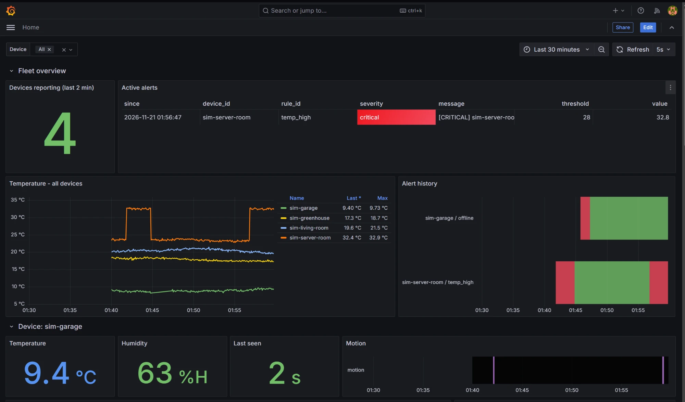
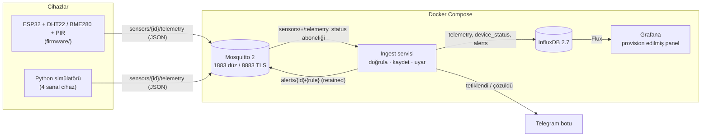

# IoT Sensor Panel

🇬🇧 [English](README.md)

[](LICENSE)


Baştan sona kurulmuş akıllı bir sensör paneli: ESP32 sensör düğümleri (ya da bir
Python simülatörü) sıcaklık, nem, basınç ve hareket verisini MQTT üzerinden
yayınlar (publish), bir Python servisi bu okumaları doğrulayıp InfluxDB 2'ye
kaydeder ve Grafana her cihaz için canlı bir panel gösterir. Eşik değeri ve
çevrimdışı (offline) uyarıları Telegram'a gider.

En çok önem verdiğim kısım **güvenlik vitrini**: aynı yığın hem `insecure`
modunda (düz MQTT, anonim erişim) hem de `secure` modunda (TLS, parolalar,
cihaz başına ACL) çalışıyor ve aradaki farkı gösteren bir Wireshark anlatımı
var.



*Panel, simüle edilmiş sensörlerle kendi bilgisayarımda çalışırken: sunucu
odasında kritik sıcaklık alarmı var; alarm geçmişinde garaj sensörünün
çevrimdışı olup geri geldiği görülüyor.*

| Canlı panel | Telegram'da uyarılar |
| --- | --- |
| *Demo GIF yer tutucusu: `docs/img/dashboard-demo.gif` (henüz kaydedilmedi)* | *Ekran görüntüsü yer tutucusu: `docs/img/telegram-alert.png`* |

Her görselin neyi göstereceği için [docs/img/README.tr.md](docs/img/README.tr.md)
dosyasına bak.

## Mimari



- **Simülatör** (`src/iot_panel/simulator.py`): gün içi sıcaklık eğrisi,
  ortalamaya dönen sapma, sensör gürültüsü, sıcaklıkla ters ilişkili nem, günün
  saatine bağlı hareket; sessiz kalan cihazlar ve ani ısınmalar için hata
  enjeksiyonu.
- **Ingest** (`src/iot_panel/ingest.py`): sıkı payload doğrulaması (tipler,
  fiziksel aralıklar, zaman damgası sapması, `device_id` topic ile eşleşmeli),
  toplu (batch) InfluxDB yazımı, uyarı değerlendirmesi.
- **Uyarılar** (`src/iot_panel/alerts/`): histerezisli YAML kuralları, cihaz
  başına geçersiz kılmalar (override), çevrimdışı tespiti, Telegram/konsol
  bildirimleri, uyarı durumunun MQTT ve InfluxDB'de tutulması.
- **Firmware** (`firmware/`): DHT22 ya da BME280'li ESP32 için PlatformIO
  projesi; isteğe bağlı PIR, sabitlenmiş (pinned) CA ile TLS.

## Hızlı başlangıç

Gereksinim: Compose v2 yüklü Docker.

```bash
docker compose up --build
```

Sonra <http://localhost:3000> adresini aç (kullanıcı `admin`, parola
`change-me-grafana`). **IoT Sensor Panel** paneli ana sayfadır: birkaç saniye
içinde dört simüle cihaz görünür. Yerleşik demo hataları her 15 dakikada bir
sunucu odasını aşırı ısıtır ve garaj sensörünü susturur; böylece uyarıların
tetiklenip çözülmesini izleyebilirsin.

Her ayarın bir geliştirme varsayılanı var. Parolaları, token'ları ya da
simülatörü değiştirmek için ilk başlatmadan önce `.env.example` dosyasını
`.env` olarak kopyalayıp düzenle (InfluxDB kurulumunu yalnızca bir kez, boş bir
volume üzerinde uygular).

| Servis | URL / port |
| --- | --- |
| Grafana | <http://localhost:3000> |
| InfluxDB arayüzü | <http://localhost:8086> (`admin` / `change-me-influx`) |
| MQTT | `localhost:1883` (insecure) veya `localhost:8883` (secure) |

### Docker olmadan

Python tarafı Python 3.11+ olan her yerde çalışır:

```bash
python -m venv .venv && source .venv/bin/activate   # Windows: .venv\Scripts\activate
pip install -e ".[dev]"

# simüle edilen telemetriyi yayınlamak yerine ekrana yazdır
iot-simulator --dry-run --count 3

# 10 dakikayı hızlandır: ani ısınma ve sessiz bir cihazla
iot-simulator --dry-run --fast --interval 10 --count 60 \
  --spike sim-server-room:120:180:9 --silence sim-garage:200:200
```

## Telemetri payload'ı

Hem simülatör hem de firmware tarafından `sensors/<device_id>/telemetry`
topic'ine yayınlanır:

```json
{
  "v": 1,
  "device_id": "sim-server-room",
  "ts": 1763496000.25,
  "seq": 42,
  "temperature": 24.31,
  "humidity": 35.2,
  "pressure": 1009.8,
  "motion": false,
  "rssi": -61,
  "fw": "sim-0.1.0"
}
```

`ts` isteğe bağlıdır (yoksa ingest servisi alınma zamanını kullanır);
`temperature`, `humidity`, `pressure`, `motion` alanlarından en az biri
zorunludur. Sensörlerin fiziksel aralığının dışında kalan, `device_id` değeri
topic'ten farklı olan ya da zaman damgası gelecekte beş dakikadan fazla olan
okumalar reddedilir ve sayılır, asla kaydedilmez. Cihazlar ayrıca
`sensors/<device_id>/status` topic'ine, MQTT last will (son istek) ile birlikte
retained bir `online`/`offline` durumu yayınlar.

## Uyarılar

Kurallar, ingest container'ına bağlanan (mount edilen)
[`config/alerts.yaml`](config/alerts.yaml) dosyasındadır (düzenledikten sonra
`ingest` servisini yeniden başlat):

```yaml
offline:
  timeout_seconds: 60          # 60 sn telemetri yok -> "offline"
  check_interval_seconds: 5
  severity: critical

rules:
  - id: temp_high
    metric: temperature
    above: 30.0                # > 30.0 olunca tetiklenir
    hysteresis: 1.0            # yalnızca < 29.0 olunca çözülür
    severity: warning

devices:
  sim-server-room:
    offline_timeout_seconds: 30
    rules:
      temp_high: {above: 28.0, severity: critical}
```

- **Histerezis**, eşik civarında gezinen bir değerin bildirim yağmuru yerine tek
  bir uyarı üretmesi demektir. `tests/test_alert_rules.py` aynı gürültülü sinyali
  histerezisli ve histerezissiz besleyerek farkı gösterir.
- **Çevrimdışı tespiti**, N saniyedir veri göndermeyen bir cihazı bildirir
  (cihaz başına ayarlanabilir) ve geri geldiğinde bir düzelme bildirimi yollar.
  `expected_devices` ise hiç veri göndermemiş bir cihazı da yakalar.
- **Bildirimler:** uyarılar her zaman ingest servisi tarafından loglanır.
  Telegram'da almak için @BotFather ile bir bot oluştur ve `.env` içinde
  `TELEGRAM_BOT_TOKEN` ile `TELEGRAM_CHAT_ID` değerlerini ayarla. Çözüldü
  bildirimleri sessiz olarak gönderilir.
- **Grafana için durum:** her geçiş `alerts` measurement'ına yazılır (*Active
  alerts* tablosunda ve *Alert history* zaman çizelgesinde gösterilir) ve
  `alerts/<device_id>/<rule_id>` topic'ine retained olarak yayınlanır. Yeniden
  başlatmadan sonra ingest servisi bu retained durumu geri okur; böylece servis
  kapalıyken çözülen bir uyarı yine doğru şekilde çözülmüş sayılır.

## Donanım

Firmware birebir aynı payload'ı yayınlar; yani gerçek bir kart panelde simüle
edilenlerin yanında görünür.

| Sensör | ESP32 pinleri | PlatformIO env |
| --- | --- | --- |
| DHT22 | DATA -> GPIO 4 (3V3'e 10 kΩ pull-up) | `esp32-dht22` |
| BME280 (I2C, 0x76) | SDA -> GPIO 21, SCL -> GPIO 22 | `esp32-bme280` |
| HC-SR501 PIR (isteğe bağlı) | OUT -> GPIO 27, VCC -> 5V | ikisi de |

```bash
cd firmware
cp include/secrets.example.h include/secrets.h   # WiFi, broker, parola, CA sertifikası
pio run -e esp32-dht22 -t upload && pio device monitor
```

`secrets.h` git tarafından yok sayılır (git-ignored). `MQTT_USE_TLS 1` iken kart,
broker'ı yerel CA'ya karşı doğrular (sertifikanın geçerlilik süresi
kontrol edilebilsin diye saat önce NTP ile senkronlanır). Tam bağlantı
tabloları, malzeme listesi (BOM) ve bir kart için güvenli kurulum
[docs/hardware.tr.md](docs/hardware.tr.md) dosyasında.

*Fotoğraf yer tutucusu: `docs/img/hardware.jpg`*

## Güvenlik: önce ve sonra

| | `insecure` (varsayılan) | `secure` |
| --- | --- | --- |
| Taşıma | 1883'te düz TCP | yalnızca 8883'te TLS 1.2+ |
| Kim bağlanabilir | herkes | yalnızca kullanıcı adı + parola ile |
| Kim nereye publish edebilir | herkes, her yere | her cihaz yalnızca `sensors/<kendi id'si>/...` topic'lerine (ACL) |
| Broker kimliği | doğrulanmaz | yerel bir CA'dan sertifika, host adı kontrol edilir |
| InfluxDB / Grafana | tüm arayüzler | yalnızca `127.0.0.1` |

| Ağda düz MQTT | Ağda TLS üzerinden MQTT |
| --- | --- |
| *Ekran görüntüsü yer tutucusu: `docs/img/wireshark-insecure.png` - topic, JSON payload ve CONNECT parolası okunabiliyor* | *Ekran görüntüsü yer tutucusu: `docs/img/wireshark-secure.png` - TLS handshake, sonrasında yalnızca Application Data* |

Güvenli yığını çalıştırmak için:

```bash
cp .env.example .env                              # gerçek MQTT parolalarını ayarla
python scripts/gen_certs.py                       # yerel CA + broker sertifikası (veya scripts/gen_certs.sh)
python scripts/make_passwd.py --from-env .env     # Mosquitto parola dosyası
docker compose -f docker-compose.yml -f docker-compose.secure.yml up --build
```

Sertifikalar, parola dosyası ve `.env` yerelde üretilir ve git tarafından yok
sayılır. Adım adım yakalama rehberi (yakalama filtreleri, Docker Desktop ile
nerede yakalanacağı, her modda neler göründüğü, ACL'nin sahte bir cihazı nasıl
durdurduğunun gösterilmesi) [docs/security-demo.tr.md](docs/security-demo.tr.md)
dosyasında.

Asıl iddia otomatik olarak da test edilir: `tests/test_tls_wire.py`, gerçek MQTT
istemci kodu ile sahte bir broker arasına kayıt yapan bir TCP proxy koyar; düz
MQTT'de parolanın ve payload'ın yakalanan baytlarda bulunduğunu, TLS'de ise
bulunmadığını doğrular. Ayrıca başka bir CA'dan ya da başka bir host adı için
verilmiş sertifikaya sahip bir broker'ın reddedildiğini de doğrular.

## Proje yapısı

```
.
├── src/iot_panel/          # simulator, ingest service, alerting (Python package)
│   └── alerts/             # rule config, state machine, notifiers/sinks
├── config/alerts.yaml      # alert rules
├── firmware/               # ESP32 PlatformIO project
├── grafana/                # datasource + dashboard provisioning, dashboard JSON
├── mosquitto/config/       # insecure/secure broker config, ACL
├── scripts/                # cert + password generation, smoke test
├── tests/                  # pytest suite
├── docs/                   # hardware guide, security demo
├── docker-compose.yml      # insecure stack (default)
└── docker-compose.secure.yml
```

## Geliştirme

```bash
pip install -e ".[dev]"
pytest              # unit + integration tests, no Docker needed
ruff check . && ruff format --check .
```

Testler şunları kapsar: payload doğrulaması, sahte saatle histerezis ve
çevrimdışı tespiti, simülatör, sahte MQTT/InfluxDB istemcileriyle ingest
servisi, süreç içi simülatör -> ingest -> uyarı hattı, Telegram istekleri,
sertifika ve parola dosyası üretimi, ayrıca Compose, Mosquitto, ACL ve Grafana
dosyalarının statik kontrolleri.

CI (`.github/workflows/ci.yml`) Python 3.11-3.13 üzerinde ruff ve pytest
çalıştırır, her iki Compose kurulumunu `docker compose config` ile doğrular,
image'ı build eder, iki yığının uçtan uca smoke testini (`scripts/smoke_test.sh`)
çalıştırır ve her iki firmware varyantını PlatformIO ile derler.

## Bunu neden yaptım / ne öğrendim

Breadboard üzerindeki bir sensörden başlayıp bir panele ve telefonumdaki bir
uyarıya kadar uzanan tek bir proje istedim; "değer seri monitörde görünüyor"
noktasında biten bir tutorial daha değil. Tüm zinciri yapmak gerçek işin nerede
olduğunu gösterdi:

- **Doğrulama, veri alımı (ingestion) sınırında yapılmalı.** Bağlantısı gevşek
  bir DHT22 gönül rahatlığıyla 150 °C ya da NaN bildirir. Fiziksel olarak
  imkansız değerleri reddetmek ve `device_id` değerinin topic ile eşleştiğini
  kontrol etmek zaman serisini temiz tuttu ve aynı zamanda bir güvenlik kontrolü
  olduğu ortaya çıktı.
- **Uyarılar sadece eşik değil, durum da ister.** 30 °C üzerindeki her örnek
  için mesaj göndermek izleme değil, gürültüdür. Histerezis, yalnızca geçişlerde
  olay üretme, düzelme bildirimleri ve durumun yeniden başlatmalar boyunca
  saklanması uyarıları işe yarar kılan şeylerdir.
  Saati dışarıdan vermek (clock injection), çevrimdışı mantığını milisaniyeler
  içinde test edilebilir hale getirdi.
- **"Benim LAN'ımda çalışıyor" güvenlik değildir.** Kendi trafiğimin paket
  yakalamasında JSON'u ve bir parolayı görmek, TLS'in gerekliliğini herhangi bir
  makaleden daha iyi anlatıyor. TLS tek başına da yetmez: ACL olmadan geçerli
  kimlik bilgilerine sahip ele geçirilmiş tek bir sensör yine de diğerlerinin
  hepsinin kimliğine bürünebilir.
- **Mikrodenetleyicide TLS'in keskin köşeleri var:** ESP32'nin açılışta saati
  yoktur, bu yüzden NTP senkronize olana kadar sertifika doğrulaması başarısız
  olur; ayrıca broker sertifikasının subjectAltName alanında kartın bağlandığı
  tam host adı ya da IP bulunmalıdır.
- **Paneller için kod olarak altyapı (infrastructure as code).** Grafana
  datasource'unu ve panelini dosyalardan provision etmek, `docker compose up`
  komutunun her seferinde aynı sonucu vermesi demek; panel ayrıca bir pull
  request içinde gözden geçirilebiliyor.

## Bilinen sınırlamalar

- ESP32 firmware'i PubSubClient kullanır (QoS 0 ile publish) ve çevrimdışıyken
  okumaları tamponlamaz.
- Simüle cihazlar tek bir parolayı paylaşır (yine de her birinin kendi kullanıcı
  adı ve ACL kapsamı vardır); gerçek cihazlara ayrı ayrı parola verilmeli.
- İstemci sertifikası (mTLS), sertifika yenileme (rotation) ya da iptal
  (revocation) yok; InfluxDB ve Grafana Docker ağı içinde düz HTTP konuşuyor.
- Uyarı motoru durumu ingest örneği başına bellekte tutar; birden fazla ingest
  replikası çalıştırmak paylaşılan bir durum gerektirir.

## Lisans

[MIT](LICENSE) © 2026 Emre Özaydın
